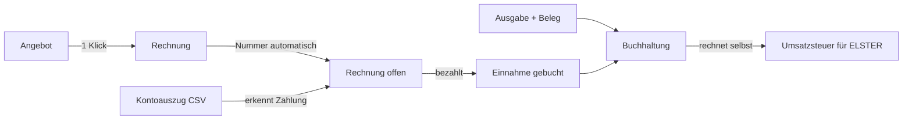
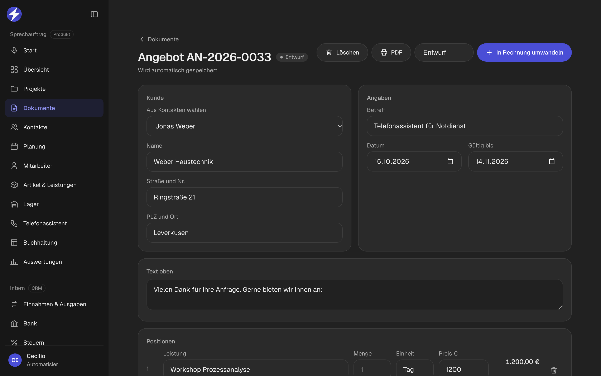
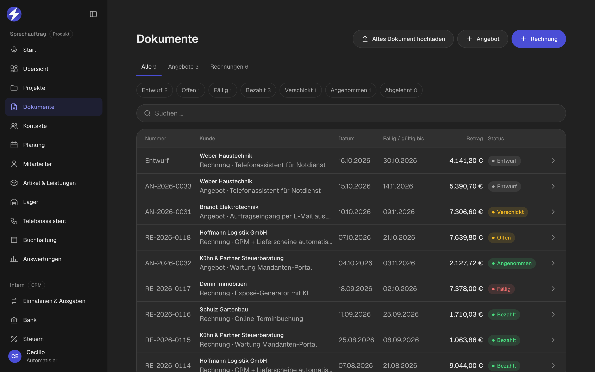
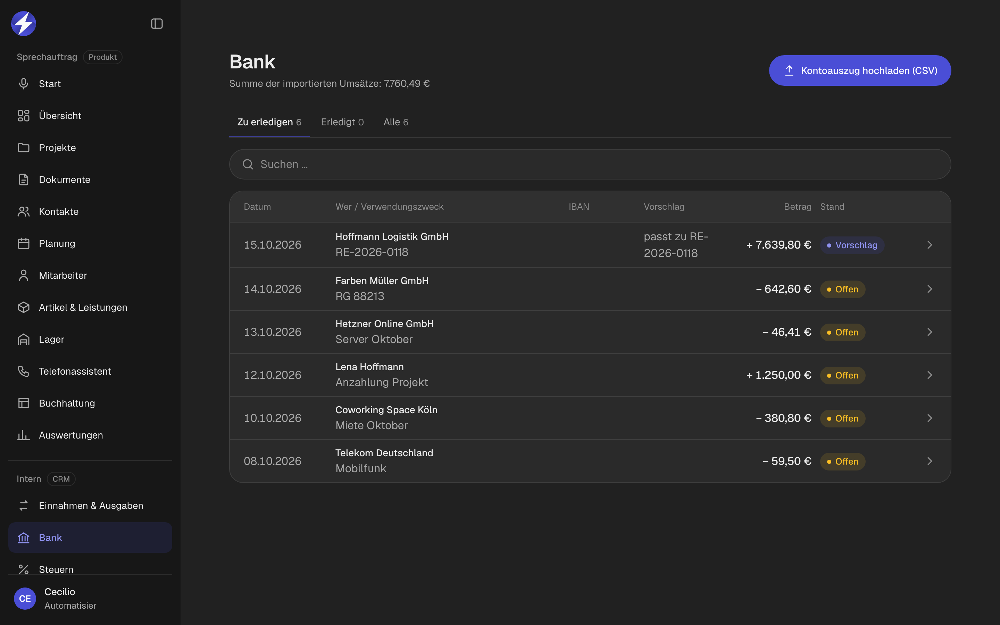
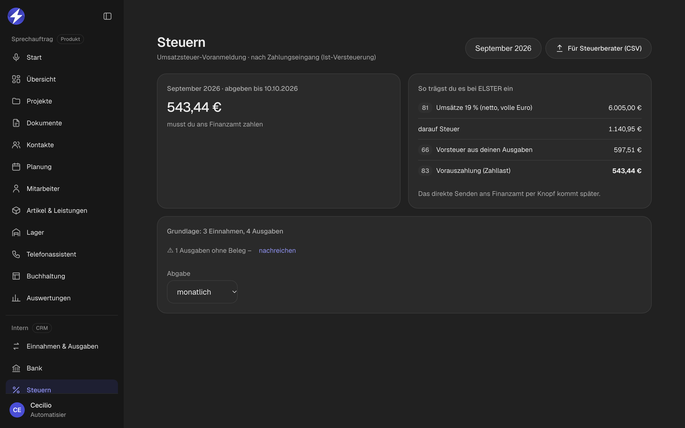
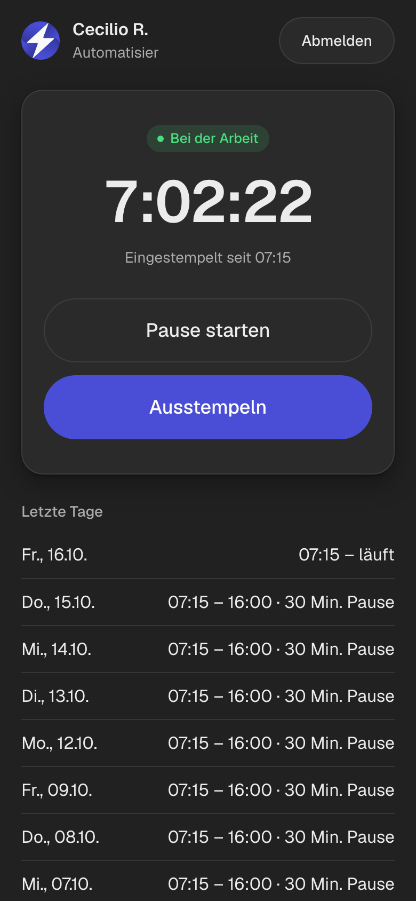
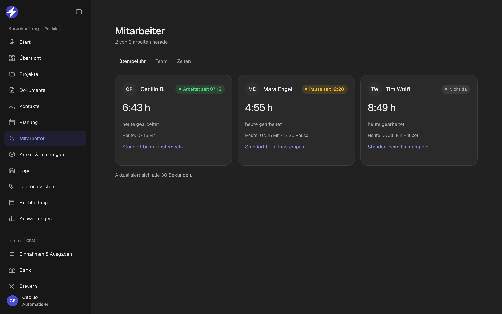
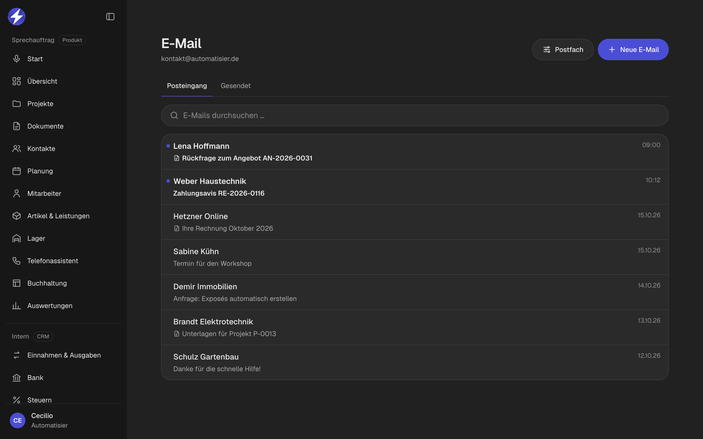
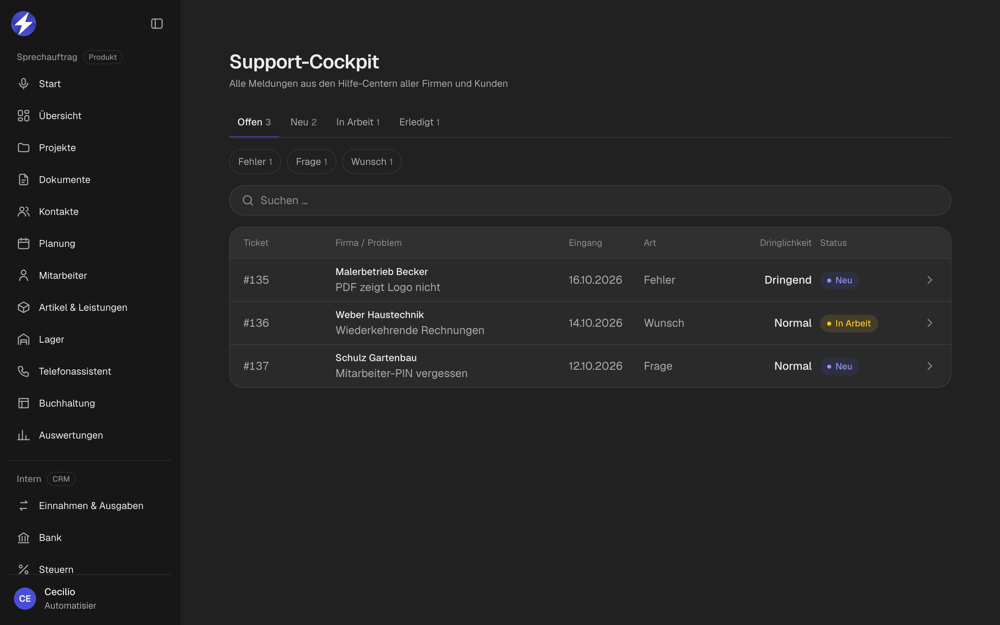

# Automatisierungen

**9 Automatisierungen, die in meinem CRM jeden Tag Büroarbeit sparen.**
Vom Angebot bis zur Steuer: einmal eintippen, der Rest läuft von selbst.

---

## Der Ablauf auf einen Blick

Alle Automatisierungen laufen in meinem selbst gebauten CRM → [automatisier-crm](https://github.com/ciliooo/automatisier-crm)

> Alle Screenshots zeigen **erfundene Demo-Daten**.

---

## 1. Angebot → Rechnung mit einem Klick

**Problem:** Wird ein Angebot angenommen, tippt man alles noch einmal in eine Rechnung ab.
**Lösung:** Knopf „In Rechnung umwandeln“. Kunde, Positionen, Preise und Betreff werden übernommen.
**Ergebnis:** Die Rechnung steht in Sekunden, ohne Tippfehler.

## 2. Rechnungsnummern automatisch und lückenlos

**Problem:** Rechnungsnummern müssen fortlaufend und ohne Lücken sein, sonst gibt's Ärger mit dem Finanzamt.
**Lösung:** Die Nummer (z. B. `RE-2026-0118`) vergibt die **Datenbank** erst beim Abschließen. Danach ist die Rechnung festgeschrieben und kann nur noch storniert werden.
**Ergebnis:** Keine doppelten oder fehlenden Nummern, auch wenn mehrere Leute gleichzeitig arbeiten.

## 3. Rechnung bezahlt → automatisch als Einnahme gebucht

**Problem:** Jede bezahlte Rechnung muss noch einmal in der Buchhaltung erfasst werden.
**Lösung:** Sobald eine Rechnung als bezahlt markiert wird, entsteht automatisch die passende Einnahme – mit Betrag, Steuersatz und Kunde. Doppelte Buchungen sind ausgeschlossen.
**Ergebnis:** Buchhaltung und Rechnungen passen immer zusammen.

## 4. Bank-Abgleich: Zahlung erkennt ihre Rechnung

**Problem:** Kontoauszug durchgehen und jede Zahlung von Hand der richtigen Rechnung zuordnen.
**Lösung:** Kontoauszug als CSV aus dem Online-Banking hochladen. Die App sucht die **Rechnungsnummer im Verwendungszweck** oder einen **passenden Betrag** und macht einen Vorschlag. Ein Klick → Rechnung bezahlt und gebucht.
**Ergebnis:** Der Monatsabgleich dauert Minuten statt Stunden.

## 5. Umsatzsteuer rechnet sich selbst

**Problem:** Für die Umsatzsteuer-Voranmeldung alle Einnahmen und Ausgaben zusammensuchen und rechnen.
**Lösung:** Die App rechnet aus den Buchungen die fertigen **ELSTER-Kennzahlen** (81, 66, 83) – monatlich oder vierteljährlich, Soll- oder Ist-Versteuerung, auch für Kleinunternehmer. Dazu ein **CSV-Export für den Steuerberater**.
**Ergebnis:** Werte abtippen, fertig.

## 6. Beleg-Kontrolle

**Problem:** Am Jahresende fehlen Belege, und keiner weiß mehr, welche.
**Lösung:** Jede Ausgabe ohne Foto oder PDF wird markiert („Beleg fehlt“), der Filter „Ohne Beleg“ zeigt alle auf einmal. Auch die Steuer-Seite warnt.
**Ergebnis:** Belege werden sofort nachgereicht statt Monate später gesucht.

## 7. Zeiterfassung per Handy

| Stempel-App für Mitarbeiter | Live-Übersicht für den Chef |
|:---:|:---:|
|  |  |

**Problem:** Stundenzettel auf Papier, die am Monatsende abgetippt werden.
**Lösung:** Mitarbeiter stempeln mit Firmen-Code, Name und PIN auf dem Handy ein und aus – mit Pausen und Standort. Der Chef sieht live, wer gerade arbeitet. Stunden und Pausen werden automatisch zusammengerechnet.
**Ergebnis:** Fertige Monatszeiten pro Mitarbeiter, ohne Zettel.

## 8. E-Mail direkt im CRM

**Problem:** Zwischen Mailprogramm und CRM hin- und herspringen.
**Lösung:** Jede Firma verbindet ihr eigenes Postfach (IMAP/SMTP). Mails lesen, beantworten und senden direkt in der App. Die Zugangsdaten liegen verschlüsselt in der Datenbank.
**Ergebnis:** Kundenkontakt und Aufträge an einem Ort.

## 9. Support-Tickets laufen automatisch zusammen

**Problem:** Fehlermeldungen und Wünsche kommen per WhatsApp, Anruf und Mail – und gehen unter.
**Lösung:** Jede Firma meldet im Hilfe-Center Fehler, Fragen und Wünsche. Alle Meldungen landen automatisch im **Support-Cockpit** – mit Firma, Art, Dringlichkeit und Status.
**Ergebnis:** Nichts geht verloren, alles wird abgearbeitet.

---

## Technik

- **Datenbank-Logik in Supabase (Postgres):** Nummernvergabe und Mitarbeiter-Login laufen als Datenbank-Funktionen, damit sie sicher und unverfälschbar sind
- **Row Level Security:** jede Firma sieht nur ihre eigenen Daten
- **Vercel Functions** für E-Mail (IMAP/SMTP)
- **Vanilla JavaScript**, installierbar als App auf Handy und Desktop

---

**Du willst sowas auch für deine Firma?**
**[Automatisier](https://automatisier.de)** baut individuelle Automatisierungen für Firmen · Der Quellcode ist privat.

